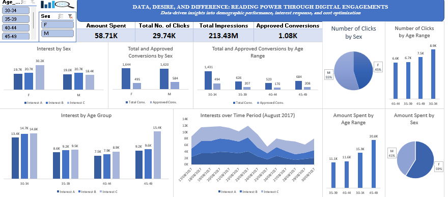

# Data, Desire, and Difference: Reading Power Through Digital Engagements
### Data-driven insights into demographic performance, interest response, and cost optimization

#### About the Project

**Data, Desire, and Difference: Reading Power Through Digital Engagements** is an interactive Microsoft Excel dashboard designed to explore digital engagement performance across demographic groups.

The dashboard brings together key indicators and visualisations to show how clicks, interests, conversions and amount spent vary by sex and age range, and how interests change over time in August 2017.

#### Project Objectives

The dashboard was created to explore five main questions:

1. How do interests (A, B and C) differ by sex and by age group?
2. How are clicks distributed across sex and age range?
3. How do total and approved conversions compare across sex and age range?
4. How does the amount spent vary by sex and age range?
5. How do interests change over the period 17/08/2017 to 30/08/2017?

#### Dashboard Preview

| Social Media Insights Dashboard |
|---|
|  |

#### Dashboard Components

##### 1. Key Performance Indicators

The dashboard opens with four key performance indicators (KPIs):

- **Amount Spent:** 58.71K
- **Total No. of Clicks:** 29.74K
- **Total Impressions:** 213.43M
- **Approved Conversions:** 1.08K

##### 2. Interest by Sex

The chart compares Interest A, Interest B and Interest C for females (F) and males (M):

| Sex | Interest A | Interest B | Interest C |
|---|---|---|---|
| F | 19.7K | 20.7K | 30.2K |
| M | 19.0K | 20.7K | 18.4K |

##### 3. Total and Approved Conversions by Sex

| Sex | Total Conversions | Approved Conversions |
|---|---|---|
| F | 1,644 | 495 |
| M | 1,620 | 584 |

##### 4. Total and Approved Conversions by Age Range

| Age Range | Total Conversions | Approved Conversions |
|---|---|---|
| 30-34 | 1,431 | 494 |
| 35-39 | 626 | 207 |
| 40-44 | 523 | 170 |
| 45-49 | 684 | 208 |

##### 5. Number of Clicks by Sex

The pie chart shows that males account for 55% of clicks and females for 45%.

##### 6. Number of Clicks by Age Range

| Age Range | Clicks |
|---|---|
| 30-34 | 8.9K |
| 35-39 | 6.7K |
| 40-44 | 6.6K |
| 45-49 | 7.5K |

##### 7. Interest by Age Group

| Age Group | Interest A | Interest B | Interest C |
|---|---|---|---|
| 30-34 | 13.4K | 14.7K | 14.8K |
| 35-39 | 8.6K | 9.2K | 9.5K |
| 40-44 | 7.5K | 7.9K | 8.9K |
| 45-49 | 9.2K | 9.6K | 15.4K |

##### 8. Interests over Time Period (August 2017)

The area chart tracks Interest A, Interest B and Interest C from 17/08/2017 to 30/08/2017, showing how each interest changes over the period.

##### 9. Amount Spent by Age Range

| Age Range | Amount Spent |
|---|---|
| 30-34 | 15.3K |
| 35-39 | 11.1K |
| 40-44 | 11.6K |
| 45-49 | 20.8K |

##### 10. Amount Spent by Sex

The pie chart shows that females account for 59% of the amount spent and males for 41%.

#### Key Insights

The dashboard provides several initial observations that can guide further analysis.

##### a. Interest by Sex

Females show the highest interest in Interest C (30.2K), while males are highest in Interest B (20.7K).

##### b. Interest by Age Group

Interest C is highest in the 45-49 age group (15.4K) and in the 30-34 group (14.8K).

##### c. Conversions

Females have more total conversions (1,644 vs 1,620), while males have more approved conversions (584 vs 495). The 30-34 age range has the most total conversions (1,431) and the most approved conversions (494).

##### d. Clicks

Males account for 55% of clicks. By age range, 30-34 has the most clicks (8.9K).

##### e. Amount Spent

The 45-49 age range has the highest amount spent (20.8K). Females account for 59% of the amount spent.

These observations are descriptive findings from the displayed dashboard. They do not, on their own, establish the causes of the differences between groups.

#### Tools Used

- **Microsoft Excel** — Data cleaning, Dashboard development, Data visualisation and Interactive reporting

#### Visualisations

The dashboard uses a combination of:

- KPI cards
- Clustered column charts
- Pie charts
- Area chart
- Interactive slicers

#### Interactive Features

The dashboard is designed to support interactive exploration rather than simply present static figures.

##### i. Filter by Age

Use the Age slicer (30-34, 35-39, 40-44, 45-49) to examine performance for the selected age range.

##### ii. Filter by Sex

Use the Sex slicer (F, M) to examine performance for the selected sex.

##### iii. Compare Interests

Use the interest charts to compare Interest A, Interest B and Interest C across sex and age group.

##### iv. Explore Interests over Time

Use the area chart to examine how interests change from 17/08/2017 to 30/08/2017.

#### Project Summary

This project transforms raw marketing data into a clear, unified business narrative. Instead of forcing teams to manually piece together disparate marketing figures, this dashboard provides an avenue for theorizing on the possibility of all campaign mechanics bring combined into a single analytical source.

Stakeholders can then monitor high-level marketing performance or instantly isolate specific operational questions regarding:

• **Demographic Performance**: Breaking down user behavior, clicks, and conversion rates across different age cohorts and genders.

• **Interest Response**: Mapping how specific audience interests interact with your digital campaigns over time.

• **Cost and Efficiency**: Evaluating financial metrics to compare amount spent against approved customer conversions, amongst others.

This project demonstrates how data engineering and interactive dashboard design work together to streamline performance tracking and support data-driven advertising decisions.

#### Author:
#### Naa Akweley Marley
LinkedIn: [Naa Akweley Marley](https://www.linkedin.com/in/naa-akweley-marley)